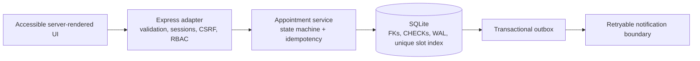

# Health Centre — reliable appointment coordination

This project is an engineering rebuild of a student health-centre appointment prototype. The original application mixed a 1,683-line router, duplicated MongoDB connections, plaintext passwords, hard-coded SMTP credentials, free-form appointment states, and no runnable tests. The active application now focuses on the core workflow and makes its guarantees explicit:

1. A patient signs in and requests an appointment.
2. A retry with the same idempotency key returns the original request instead of creating a duplicate.
3. An administrator schedules a doctor and time inside a transaction.
4. The database rejects a confirmed doctor/time collision.
5. The assigned doctor completes the appointment and records a prescription.
6. Durable outbox events and audit entries are written with the business change.

The standalone `npm run worker:notifications` process claims outbox events with expiring leases, retries transient adapter errors with capped exponential backoff, and marks exhausted events `dead`. Its default adapter writes a local console summary only; no real email is sent.

This is a local-first engineering showcase, not a production medical-record system. It intentionally does not claim HIPAA compliance, multi-region durability, real email delivery, or exactly-once external side effects.

## Why the naive version fails

The legacy code sent email before inserting the appointment, compared raw passwords, trusted identity in URL parameters, accepted whole request bodies in updates, used strings such as `not yet sheduled` as state, and had no database constraint preventing double booking. Those choices make retries, concurrent requests, and partial failures unsafe.

The corrected design is documented in:

- [`docs/engineering-audit.md`](docs/engineering-audit.md) — evidence-backed audit of the original project.
- [`docs/technical-design.md`](docs/technical-design.md) — active architecture, invariants, trade-offs, and acceptance criteria.
- [`docs/failure-analysis.md`](docs/failure-analysis.md) — failure scenarios and honest guarantees.
- [`docs/architecture.mmd`](docs/architecture.mmd) — Mermaid component diagram.

## Architecture



The active code lives under `src/`. The old `routes/` and `views/` are retained as historical reference but are not mounted by `app.js`.

### Guarantees

- Passwords are stored as bcrypt hashes, never plaintext.
- Sessions are persisted in SQLite and use HTTP-only, SameSite cookies.
- Browser mutations require a session CSRF token.
- Patient, doctor, and administrator actions are separated by server-side role checks.
- Appointment state transitions are explicit and monotonic.
- Idempotency is per actor and request payload; a conflicting reuse is rejected.
- SQLite foreign keys and a partial unique index enforce relational invariants.
- Appointment changes, audit rows, and outbox events commit atomically.
- Notification delivery is at-least-once. The system does **not** claim exactly-once email.

## Requirements

- Node.js 18.12 or newer
- npm
- No MongoDB, SMTP server, Redis, or other external service is required for the local demo.

## Install and run

```bash
npm ci
npm run seed
npm start
```

Open `http://127.0.0.1:3000`. The seed command prints local-only demo credentials. The SQLite file is created at `data/health-centre.sqlite` by default; it is ignored by Git.

Configuration can be copied from [`example.env`](example.env):

```text
PORT=3000
HEALTH_DB_PATH=./data/health-centre.sqlite
HEALTH_DEMO_PASSWORD=ChangeMe123!
COOKIE_SECURE=false
```

For production-like HTTPS, set `COOKIE_SECURE=true` and terminate TLS in front of the process. Do not use the demo password outside a disposable local environment.

## Test and quality checks

```bash
npm run lint
npm test
npm run check
```

The tests cover the state machine, input boundaries, authentication, CSRF, role boundaries, idempotent retries, durable outbox creation, duplicate-slot rejection, and atomic doctor completion.

## Reproducible demonstration

```bash
npm run demo
```

The demo runs entirely in memory and prints evidence for:

- an idempotent retry returning the same appointment,
- a successful schedule,
- a rejected duplicate doctor/time slot,
- the number of persisted appointments, and
- the number of outbox events processed by a synthetic demo adapter.

## Benchmark

```bash
npm run benchmark
```

The command runs a deterministic appointment-service workload in isolated in-memory SQLite databases and writes raw results to `bench/results/latest.json`. Controls:

```bash
BENCHMARK_ITERATIONS=10000 BENCHMARK_RUNS=5 npm run benchmark
```

The original implementation has no runnable benchmark baseline: its test script exits 1 and the legacy runtime depends on undeclared modules and a live MongoDB instance. The benchmark therefore reports only measurements actually produced by the rebuilt implementation and states that limitation rather than inventing a comparison.

`npm run benchmark:http` measures authenticated appointment requests through the Express HTTP stack against temporary file-backed SQLite databases. See [`docs/benchmark-report.md`](docs/benchmark-report.md) for the captured local results and limitations.

## Legacy JSON migration

The legacy appointment export can be reviewed with a read-only dry run:

```bash
npm run migrate:legacy -- --source=appointmentsdatabase.json --db=data/health-centre.sqlite
```

The importer never reads the legacy login files or migrates passwords/accounts. It considers only unscheduled appointments whose email matches an existing patient account in the target database. Scheduled rows need a verified doctor/status mapping and are left for manual review. The source file is not changed. See [`docs/legacy-json-migration.md`](docs/legacy-json-migration.md) before using `--apply`.

## Operational endpoints

- `GET /healthz` — process liveness.
- `GET /readyz` — database readiness.
- `GET /metrics` — small Prometheus-compatible counter output.

## Security notes

The repository originally contained a hard-coded SMTP credential and plaintext sample passwords. The active application does not use those values. Before sharing the repository or deploying any historical code, rotate any credential that may have been exposed and treat the legacy exports as untrusted sample data.

## Deliberate non-goals

This milestone does not add Kubernetes, Kafka, Redis, microservices, a React rewrite, or AI. Those technologies would increase operational surface without fixing the actual defects found in the original system. A future PostgreSQL adapter and a real provider-backed notification worker are more defensible next steps if scale or integration requirements justify them.

## Project status

The reliable appointment core is implemented and tested. Legacy features such as the original blood-donation and feedback pages are not part of the active runtime yet; they remain migration candidates rather than being presented as production-ready functionality.
