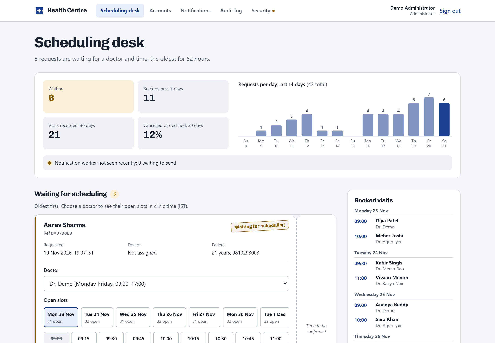
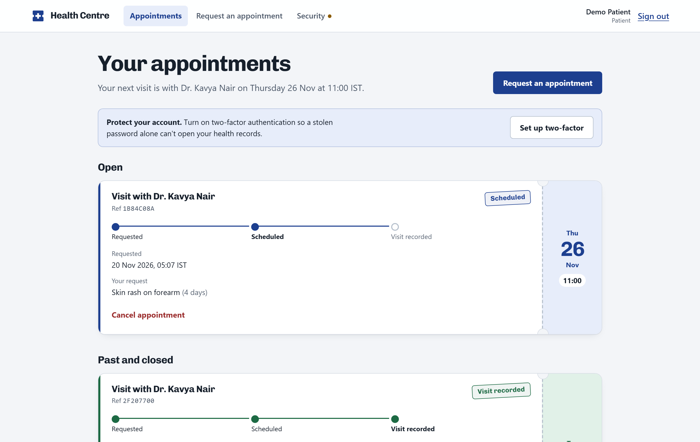
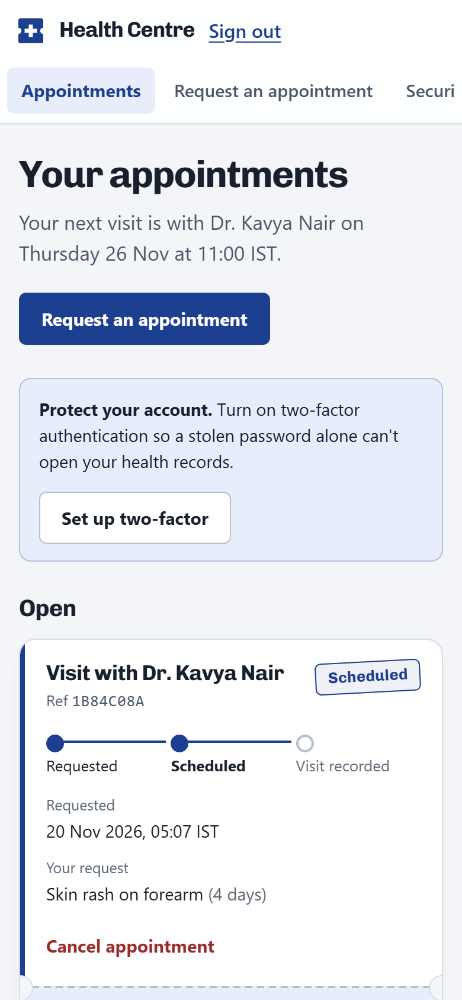
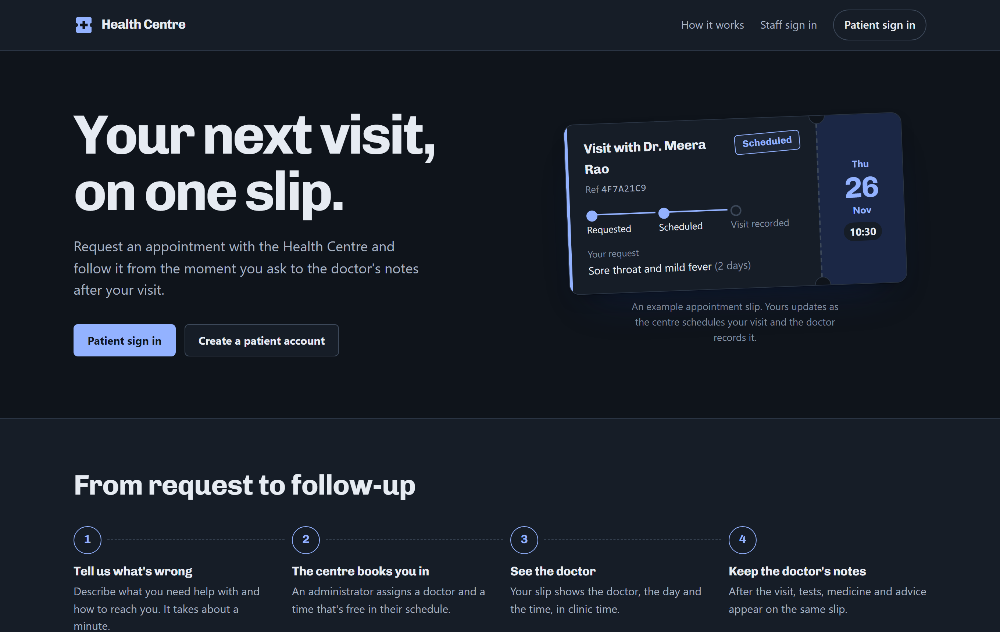

# Health Centre

An appointment booking system for a campus health centre. Patients request a visit, the centre's administrator books it into a doctor's free slot, and the doctor records the outcome after the visit. Everyone follows the same appointment from their own dashboard.

**Live demo:** https://health-center.duckdns.org (synthetic data, reset every night)

| Role | Email | Sign in at |
|---|---|---|
| Patient | `patient@health.local` | `/login/patient` |
| Doctor | `doctor@health.local` | `/login/doctor` |
| Administrator | `admin@health.local` | `/login/admin` |

Password for all three: `REPLACE_WITH_DEMO_PASSWORD`

Please don't enter real personal or medical information. This is a student project and isn't affiliated with IIT Indore.



## What it does

**Patients**
- Create an account (email and password, or Google if it's configured) and request an appointment.
- Follow each request on an appointment slip: requested, scheduled with a doctor and time, then visit recorded.
- Read the doctor's notes (tests, medicine, advice) after the visit.
- Cancel a request, and optionally turn on two-factor authentication.

**Doctors**
- See today's visits, upcoming visits and past visits that still need notes.
- Record the outcome of a visit, which the patient then sees on their slip.

**Administrators**
- Work through the queue of new requests, oldest first.
- Pick a doctor and choose from their free slots. Booked times are greyed out, and times are always in clinic time (IST).
- See requests per day for the last two weeks, upcoming bookings and whether notifications are being sent.
- Create patient and doctor accounts, disable accounts, and reset a user's two-factor authentication.
- Browse the audit log of every sensitive action.

| Patient view | On a phone | Dark mode |
|---|---|---|
|  |  |  |

## How it works

The app is a server-rendered Node.js application. Express handles the routes, EJS renders the pages, and SQLite (through `better-sqlite3`) stores everything. A small amount of plain JavaScript adds the slot picker and form niceties, and every form still works without it.

A few design decisions do most of the work:

- **No double booking.** Appointments use fixed 15-minute slots inside each doctor's working hours. A unique index on `(doctor, time)` means two confirmed visits can't overlap, even if two administrators book at the same moment.
- **Clinic time everywhere.** Times entered in the browser are read as IST, whatever time zone the server runs in, and shown back in IST.
- **Nothing is lost or duplicated.** Creating or changing an appointment writes the change, an audit record and a notification event in one database transaction. Retrying a booking request with the same key returns the original appointment instead of creating a second one.
- **Notifications run in a separate worker.** The worker picks up notification events, retries failures with increasing delays, and parks events that keep failing so an administrator can re-send them. Right now it logs to the console; there's no email provider connected.
- **Security.**
  - Passwords are hashed with bcrypt, and sessions are stored only as hashes.
  - Every form has a CSRF token, and repeated failed sign-ins are throttled.
  - Two-factor authentication uses standard authenticator-app codes. The secrets are encrypted at rest, and each code works only once.
  - Doctors and administrators must use two-factor authentication in production.

The engineering write-up is in [docs/case-study.md](docs/case-study.md), and the full audit is in [docs/industry-readiness-audit.md](docs/industry-readiness-audit.md).

## Tech stack

Node.js 24, Express 4, EJS, SQLite (`better-sqlite3`), Zod for input validation, Pino for logging. Tested with Node's built-in test runner, Supertest and Playwright with axe. Deployed with Docker Compose and Caddy (automatic HTTPS), with CI on GitHub Actions.

## Running it locally

You need Node.js 24 or newer.

```bash
git clone https://github.com/pranaykr43/IITI_HEALTH_CENTER.git
cd IITI_HEALTH_CENTER
npm ci
HEALTH_DEMO_PASSWORD='pick-a-long-password' npm run seed:showcase
HEALTH_DEMO_PASSWORD='pick-a-long-password' npm start
```

Open http://127.0.0.1:3000 and sign in with any of the demo emails above, using the password you picked. `seed:showcase` fills the database with a few doctors, patients and two weeks of sample appointments. Use `npm run seed` instead if you only want the three basic accounts.

To run the notification worker as well, start it in a second terminal with `npm run worker:notifications`.

Settings live in a `.env` file. Copy [example.env](example.env) to get started. Every setting is described in [docs/production-configuration.md](docs/production-configuration.md).

## Tests

```bash
npm run check      # lint + unit and integration tests
npm run test:e2e   # browser tests in Chromium, Firefox and WebKit
```

The browser tests run against a temporary database and need the Playwright browsers installed once with `npx playwright install chromium firefox webkit`. CI runs everything on every push, plus a dependency audit and a test build of the Docker image for ARM servers.

## Deploying

[docs/deploy-free.md](docs/deploy-free.md) shows how to host it for free on an Oracle Cloud Always Free VM, with a DuckDNS hostname and automatic HTTPS. Once the VM exists, it's one command:

```bash
bash install.sh --host your-name.duckdns.org --mode showcase
```

Use `--mode production` for a private setup with no demo accounts. Updates go through `deploy/update.sh`, which backs up the database before pulling the new version.

## Useful scripts

| Command | What it does |
|---|---|
| `npm start` / `npm run dev` | Start the web server (`dev` restarts on file changes) |
| `npm run worker:notifications` | Start the notification worker |
| `npm run seed` / `npm run seed:showcase` | Add demo accounts / demo accounts plus sample data (not allowed in production) |
| `npm run admin:create` | Create the first administrator on a production server (interactive) |
| `npm run db:backup -- <file>` | Take a checked, consistent backup of the database |
| `npm run db:restore -- <file> --confirm-stopped` | Restore a backup (stop the app first) |
| `npm run demo` | Run a scripted booking scenario in memory and print what happened |
| `npm run benchmark` | Time appointment creation locally |

## Project layout

```
src/
  http/          Express app, routes, middleware
  services/      appointments, accounts, auth, two-factor, insights, audit log
  domain/        appointment state rules, clinic-time helpers
  db/            schema and migrations
  views/         EJS pages and partials
  public/        CSS, browser script, fonts
  workers/       notification worker
test/            unit and integration tests
e2e/             Playwright browser tests
deploy/          server install, update and demo-reset scripts
scripts/         seeding, backups, benchmarks, screenshots
docs/            guides, audit, security review, case study
```

## Background

This started in 2023 as a software engineering course project. That first version used MongoDB and a single 1,700-line router, compared passwords in plain text, and could book two patients into the same slot. It was later rebuilt around the guarantees described above. The old code is still in `routes/` and `views/` for reference, but the app doesn't use it.

## More documentation

- [Free deployment guide](docs/deploy-free.md)
- [Configuration reference](docs/production-configuration.md)
- [Google sign-in setup](docs/google-sign-in.md)
- [Backup and restore](docs/backup-and-restore-production.md)
- [Security review](docs/security-review.md)
- [Production readiness checklist](docs/production-readiness-checklist.md)
- [Roadmap](docs/engineering-roadmap.md)

## License

MIT. See [LICENSE](LICENSE).
