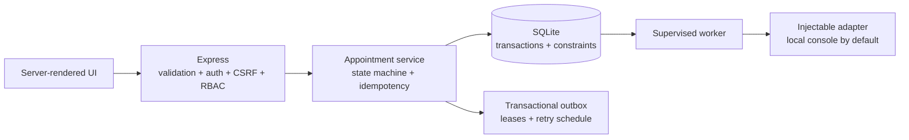

# Current engineering review

**Reviewed:** 2026-11-09

**Code state:** `feature/browser-regression` after adding isolated Chromium browser verification to the notification-worker milestone.
**Purpose:** Appointment intake, administrator scheduling, and doctor completion in a local-first engineering showcase.

## Verdict

The rebuilt application is a credible, tested single-node appointment workflow. It is a substantial improvement over the original Express/Mongo prototype: it has typed request boundaries, authenticated roles, database-enforced scheduling invariants, transactional audit/outbox writes, and a separately supervised retrying worker.

It is **not a production medical-record system**. The default notification adapter only logs locally, account provisioning and recovery are demo-oriented, observability is process-local, and the SQLite deployment model assumes one local database file. The repository contains historical legacy paths and a local worktree also contains uncommitted legacy changes and JSON exports; those are outside the rebuilt runtime and must stay out of feature commits.

## Findings

| Priority | Component | Finding and failure scenario | Current treatment / next action |
|---|---|---|---|
| P1 | Production configuration and seed flow | The former config used `ChangeMe123!` as the password fallback in every environment, and unknown `COOKIE_SECURE` values silently became `false`. A production deployment could accidentally create known demo accounts or issue an insecure session cookie. | Fixed in this branch: demo password fallback is development-only, demo seeding is rejected in production, production requires secure cookies, and invalid boolean values fail startup. `test/config.test.js` covers these cases. |
| P1 | Accounts and authentication lifecycle | The runtime has sign-in and sign-out, but no self-service enrollment, password reset, MFA, account lockout, or audited operator provisioning flow. The seed users are synthetic and not a production identity system. | Keep the app demo-only until a verified account provisioning and recovery process exists. Add lockout/risk controls only with a defined deployment and support model. |
| P1 | Notification side effects | The console adapter is not a provider and does not notify patients. A real provider can accept an event and the process can crash before the database acknowledgement, so the event may be attempted again. | The worker uses stable event IDs, leases, fencing, capped retries, and terminal `dead` status; see `test/notification-worker.test.js`. Any future provider must deduplicate by event ID and document recipient/data minimization. |
| P1 | Deployment and database scope | Rate limiting is process-local and SQLite is a shared local file. Multiple app instances on separate hosts would not share rate-limit state or database coordination. | Treat this as a single-node deployment. Do not claim horizontal scale; move to a shared transactional database and shared rate-limit strategy only when deployment needs justify them. |
| P2 | Worker lease behavior | Delivery longer than the configured lease can finish stale; a second worker may have reclaimed the event, and the old worker is correctly fenced from acknowledgement. This can cause a duplicate external side effect. | Reproduced by the fake-clock stale-worker test. Set the lease above adapter timeouts and require provider idempotency. A heartbeat/lease extension is a future option if long-running providers become necessary. |
| P2 | Worker operations | `dead` events and safe error codes are visible, but there is no operator redrive workflow or alerting/queue-depth monitor. | Add a controlled redrive action with audit records and metrics before using a real provider. Do not automatically loop terminal events. |
| P2 | Observability | `/metrics` reports in-memory HTTP and appointment counters. It does not measure database latency, outbox depth/age, retries, dead events, or worker processing duration, and counters reset on restart. | Add bounded-cardinality worker and queue metrics plus alert thresholds when there is an operator-facing deployment. |
| P2 | Browser verification | The Playwright suite covers key UI flows, roles, viewports, keyboard access, and axe checks in CI. It runs Chromium only; cross-browser behavior and full assistive-technology testing remain outside this milestone. | Add Firefox/WebKit coverage if browser support requirements expand, and pair automated checks with user testing using assistive technology. |
| P2 | Historical tree and local data | Legacy `routes/` and `views/` are retained but not mounted. Local JSON exports can contain plaintext passwords and personal/medical fields; local worktree edits include those exports. | Keep legacy files out of new commits, do not print their contents, and rotate any credential that may have been exposed. Use the dry-run importer only after mapping and backup review. |
| P2 | Benchmark scope | The recorded service and HTTP benchmarks are single-host local runs. The original runtime could not produce a valid baseline, so there is no honest before/after comparison. | See [`benchmark-report.md`](benchmark-report.md). Reproduce measurements on the same host; do not interpret them as capacity or production-storage claims. |

## Current architecture

The strongest guarantees are database-backed: appointment state, audit records, and outbox events commit together; doctor/time collisions are constrained; claims serialize through SQLite immediate transactions; and claim-token predicates fence stale workers. Delivery itself is **at least once**, not exactly once.

## Phased next work

1. **Account lifecycle:** define operator provisioning, password reset, and account disablement; test authorization when accounts change state.
2. **Provider boundary:** choose a real provider only when authorized, add idempotent delivery keyed by event ID, timeouts, and recipient minimization; do not send real data in tests.
3. **Operations:** expose outbox depth, oldest age, retry/dead counts, and worker health; add audited redrive for dead events.
4. **Browser regression:** expand beyond the initial Chromium desktop/tablet/mobile checks when supported browser requirements are defined.
5. **Deployment boundary:** document and test a single-node deployment/backup restore; evaluate PostgreSQL and shared rate limiting only if a multi-instance target is selected.

## Explicit non-goals

Do not add Kafka, Redis, Kubernetes, a microservice split, or an AI feature for appearance. None fixes a current invariant. Do not claim real notification delivery, HIPAA compliance, multi-region durability, or exactly-once side effects.

## Engineering ratings

| Area | Original prototype | Current rebuilt project | Evidence and limitation |
|---|---:|---:|---|
| Correctness | 2/10 | 8/10 | State transitions, idempotency, uniqueness, and transactional writes are tested; provider-side effects remain at least once. |
| Architecture | 2/10 | 8/10 | HTTP, service, database, and worker boundaries are explicit; current persistence remains SQLite-specific. |
| Testing | 1/10 | 8/10 | Integration, concurrency, migration, retry, crash-recovery, and fencing tests run; browser tests and property-based testing are absent. |
| Reliability | 1/10 | 7/10 | Durable outbox, leases, backoff, and bounded retries are covered; no provider, alerting, or multi-host coordination exists. |
| Security | 1/10 | 7/10 | Password hashes, sessions, CSRF, RBAC, strict production cookie config, and seed safeguards exist; account lifecycle/MFA and legacy credential cleanup remain. |
| Performance | 1/10 | 6/10 | Reproducible service and HTTP p50/p95/p99 runs exist; they are local, single-host results without a valid legacy baseline. |
| Maintainability | 2/10 | 7/10 | Active modules and docs are focused; a large historical tree and local legacy worktree changes remain. |
| Demonstration | 2/10 | 8/10 | Demo, benchmark, runbook, and manual role workflow exist; browser automation and real provider behavior are not demonstrated. |

These scores describe engineering evidence, not production readiness or clinical suitability.
