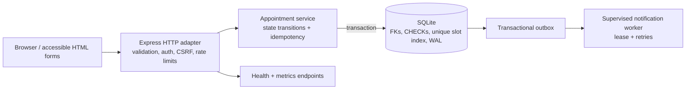

# Technical design: reliable appointment core

## Problem

The original project wants to let patients request care, administrators assign a doctor and time, and doctors complete the visit. The naive implementation stores every field as an unvalidated string, uses path parameters as identity, performs multiple writes without a transaction, and sends email before the appointment is durable.

The target is a small, local-first system that is reliable enough to demonstrate the important engineering guarantees without pretending to be a multi-region hospital platform.

## Final architecture

### Boundaries

1. **HTTP adapter** owns transport concerns: request parsing, authentication, CSRF, rate limiting, status codes, and HTML/JSON negotiation.
2. **Domain/service layer** owns appointment invariants and idempotent commands. It does not know about Express or templates.
3. **SQLite adapter** owns schema, migrations, indexes, transactions, and durable sessions. SQLite is the correct local default because the project is a single-node demo and needs a zero-service setup.
4. **Outbox worker** is a standalone, supervised process. It claims events atomically, calls an injected adapter outside the SQLite transaction, and fences acknowledgements with a lease token. The default adapter logs a local summary only; SMTP is an explicit integration point, not a hidden or active dependency.

## Important invariants

- A password is stored only as a bcrypt hash.
- A patient can create an appointment only while authenticated as that patient.
- A client retry with the same idempotency key and identical payload returns the original appointment; it creates no second row.
- Reusing an idempotency key with a different payload is rejected.
- Only `requested -> confirmed|rejected|cancelled`, `confirmed -> completed|cancelled`, and `completed/rejected/cancelled ->` no further states are legal.
- A doctor cannot have two confirmed appointments at the same exact time. SQLite enforces this with a partial unique index; the service translates the constraint failure to a conflict.
- Scheduling and its audit/outbox records commit together or not at all.
- Outbox claims are serialized in SQLite, have expiring leases, and can be acknowledged only by the current claim token before expiry.
- Adapter errors retry with capped exponential backoff; after the configured attempt limit the event is terminally marked `dead` for operator review.
- Patient history is scoped by the authenticated patient ID; email and phone are contact fields, never authorization credentials.
- Browser mutations require a session CSRF token; JSON clients may use the same token returned by login.

## Trade-offs

### SQLite instead of MongoDB

SQLite makes the demo reproducible, transactional, and testable without a daemon. It is not the final choice for a large horizontally scaled deployment. The repository isolates persistence behind a service boundary so a PostgreSQL adapter can replace it later without changing the appointment state machine.

### Server-rendered HTML instead of a frontend rewrite

The original problem is not a missing JavaScript framework. Server-rendered HTML keeps the demo small, makes accessibility and failure states visible, and avoids hiding broken backend behavior behind a dashboard shell.

### At-least-once notifications instead of exactly-once email

The database transaction guarantees durable business state plus one outbox event. Delivery can be retried and may happen more than once, including after an adapter succeeds but the worker crashes before the acknowledgement commits. Exactly-once external email is not claimed because SMTP does not provide that guarantee; a provider integration should use a provider idempotency key or deduplicate by event ID. The built-in console adapter does not send real email.

## Acceptance criteria

- `npm ci` followed by `npm run seed` and `npm start` works without MongoDB or SMTP.
- `/healthz` is live and `/readyz` proves the database is usable.
- Patient login, appointment creation, patient listing, admin scheduling, doctor completion, and logout work through the browser.
- Automated tests cover validation, authentication, ownership, idempotency, duplicate-slot rejection, state transitions, and outbox behavior.
- `npm run demo` demonstrates a retry-safe appointment and a rejected double booking.
- `npm run worker:notifications` runs a separately supervised worker with a local console adapter by default.
- `npm run benchmark` writes raw JSON with p50/p95/p99 latency and resource metadata; no benchmark number is documented unless the script actually produced it.
